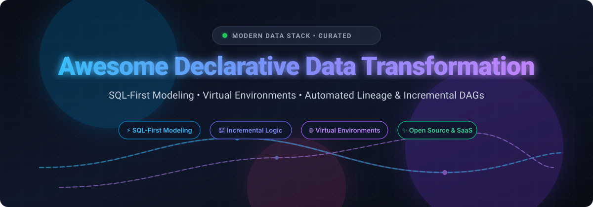

  

# 🚀 Awesome Declarative Data Transformation

  
  
  
  
  
  
  

> 🌟 **A curated directory of top declarative data transformation frameworks, SQL-first modeling tools, virtual data environments, and self-hosted transformation engines for modern analytics engineering.** 🌟

---

## 📌 Executive Summary & Key Concepts

**Declarative Data Transformation** enables analytics engineers and data teams to specify **what** business data should look like—not **how** to write low-level computation steps. Under this paradigm, transformation engines dynamically infer Directed Acyclic Graphs (DAGs), resolve inter-model dependencies, maintain column-level data lineage, orchestrate incremental materialization (tables, views, partitions), and automate regression tests across development and staging environments.

Whether you run on cloud data warehouses (**Snowflake**, **Google BigQuery**, **AWS Redshift**), lakehouse architectures (**Databricks Delta Lake**, **Apache Iceberg**), or embedded in-process engines (**DuckDB**, **Apache Arrow DataFusion**), this guide compiles the industry-leading **SaaS Platforms** and battle-tested **Open-Source GitHub Projects**.

---

## 📑 Table of Contents

- [📊 Sector Overview & Market Dynamics](#-sector-overview--market-dynamics)
- [☁️ SaaS/Hosted Platforms](#️-saashosted-platforms)
- [🔓 Open-Source GitHub Projects](#-open-source-github-projects)
- [🤝 How to Contribute](#-how-to-contribute)
- [💖 Support & Sponsorship](#-support--sponsorship)
- [📈 Star History](#-star-history)
- [⚠️ Disclaimer](#️-disclaimer)

---

## 📊 Sector Overview & Market Dynamics

The global data integration and declarative transformation sector is estimated at approximately **$16.0B to $19.1B** (2024–2025), expanding at a **12–14% CAGR** fueled by enterprise multi-cloud migrations, real-time analytics demands, and AI/LLM data pipeline prerequisites. 

The market exhibits a **moderately fragmented**, two-tiered dynamic:
1. **Infrastructure Heavyweights (Centralized Core):** Hyperscalers and mega-cap platform providers (Google Cloud Dataform, Databricks Delta Live Tables, Snowflake Dynamic Tables) capture large enterprise baseline compute budgets with tightly coupled in-engine materialization.
2. **Best-of-Breed Modern Data Stack (Agile Long-Tail):** Independent declarative engines (dbt Labs, Fivetran, Coalesce, Materialize, Tobiko Data/SQLMesh) thrive by providing multi-cloud portability, column-level lineage, virtual staging environments, and developer-first CI/CD workflows.

---

## ☁️ SaaS/Hosted Platforms

| Platform | Company Valuation / Revenue | Starting Pricing Tier | Free Tier / Trial Limits | Description & Key Trade-offs |
| :--- | :--- | :--- | :--- | :--- |
| **[Dataform](https://cloud.google.com/dataform)** (Google Cloud / Alphabet) | **~$2.0T+ Market Cap** (~$350B+ Revenue) | **$6.25 per TB** (On-demand BigQuery queries; $0.02/GB storage; $0 Dataform service fee) | **Free Forever**: 1 TB queries/month & 10 GB storage free via BigQuery Always Free tier (Plus $300 new GCP account 90-day trial) | ⚡ SQL-based transformation native to BigQuery with no license fee. **Trade-off**: BigQuery-only; no native multi-cloud or multi-warehouse support. |
| **[Databricks Delta Live Tables](https://www.databricks.com/)** | **$62B–$134B Valuation** (~$3.7B–$4.8B ARR) | **$0.20 to $0.54 per DBU** (Serverless/Classic Core compute rates) | **Free Forever**: Free Edition (1 serverless workspace, 1 small 2X-Small warehouse, daily fair-use quota); **Free Trial**: 14 days with $400 credits | 🌊 Declarative pipeline framework with streaming and data quality expectations. **Trade-off**: ADVANCED tier pricing wastes DBUs without EXPECT clauses; compute bills scale with cluster sizing. |
| **[Snowflake Dynamic Tables](https://www.snowflake.com/)** | **$45B–$65B Market Cap** (~$3.6B Revenue) | **$2.00 per credit** (Standard Edition virtual warehouse compute rate) | **Free Trial**: 30 days with $400 free credits across virtual warehouse compute and storage | 🔄 Declarative materialized tables with automated refresh. **Trade-off**: High-frequency target lags incur substantial Cloud Services metadata inspection overheads. |
| **[Fivetran Transformations](https://www.fivetran.com/)** | **$5.6B Valuation** (~$300M+ ARR) | **$0.01 per run** (Tiered from 5,001–30,000 runs; scales down to $0.002/run over 100k runs) | **Free Forever**: Up to 5,000 model runs/month and 500,000 MAR; **Free Trial**: 14 days with unlimited trial syncs & runs | 📦 Integrated dbt Core and Quickstart models within managed Fivetran pipelines. **Trade-off**: Optimized primarily for Fivetran connector syncs; large-scale transformations bill per run. |
| **[dbt Cloud](https://www.getdbt.com/)** | **$4.2B Valuation** (~$100M+ ARR) | **$100 per seat/month** (Starter tier, up to 5 seats, includes 15,000 models/month) | **Free Forever**: 1 developer seat with up to 3,000 successful model builds/month; **Free Trial**: 14-day Starter trial | 🛠️ De facto standard managed dbt environment with integrated IDE, scheduler, and semantic layer. **Trade-off**: Seat and model overage costs escalate quickly for scaling teams. |
| **[Matillion](https://www.matillion.com/)** | **$1.5B Valuation** (~$77M–$99M Revenue) | **$2.00 to $2.50 per credit** (Data Productivity Cloud Teams plan starts at ~$20,000/year) | **Free Trial**: 14 days with 500 complimentary Matillion credits | 🎨 Low-code/visual push-down ETL and in-warehouse transformation platform. **Trade-off**: Cloud data warehouse compute is billed separately on top of Matillion credits. |
| **[Coalesce.io](https://coalesce.io/)** | **$80M–$120M+ Valuation** (~$15M–$25M ARR) | **$150 per user/month** (Starter tier billed annually, up to 4 users, includes 15,000 actions/month) | **Free Forever**: Developer tier with 1 user, 1 project, and 2,000 actions/month; **Free Trial**: 30-day partner/enterprise trial | 🧩 Column-aware visual transformation canvas built specifically for Snowflake, BigQuery, and Databricks. **Trade-off**: Starter plan caps at 4 transform users; 5+ builders require custom Enterprise. |
| **[Materialize](https://materialize.com/)** | **~$177M Valuation** (~$10M–$15M ARR) | **$1.50 per compute credit** (Cloud On-Demand tier) | **Free Forever**: Self-managed Community License up to 24 GiB RAM and 48 GiB disk; **Free Trial**: 7-day full cloud trial | ⚡ Real-time streaming SQL database computing incremental materialized views. **Trade-off**: Continuous compute credit charges can accumulate quickly for 24/7 streaming clusters. |
| **[Prophecy.io](https://www.prophecy.ai/)** | **~$70M–$100M Valuation** (~$10M–$30M ARR) | **$150 per user/month** (Professional tier with 50 credits/month; Enterprise Express starts at $4,000/month) | **Free Forever**: Starter edition with 20 credits/month (runs on embedded DuckDB, managed Git) | 🤖 Visual low-code transformation generating native Spark and SQL code with generative AI agents. **Trade-off**: Credit-based execution limits; multi-engine team deployments require Enterprise tiers. |

---

## 🔓 Open-Source GitHub Projects

*Sorted by GitHub Stars_Count in descending order:*

1. ### 🦆 [DuckDB](https://github.com/duckdb/duckdb) 
   - **Type**: Embedded Analytical In-Process SQL OLAP Engine (MIT License)
   - **Overview**: Fast, zero-dependency in-process SQL OLAP database management system. DuckDB excels at declarative local transformations, querying Parquet/Arrow/CSV files directly, and powering modern fast analytical pipeline testing and embedded transformation execution without cluster management overhead.
   - **Tech Stack**: C++, C, Python, SQL.
   - **Best For**: Fast local transformations, CI/CD pipeline runs, and serverless data modeling.

2. ### ⚙️ [Prefect](https://github.com/PrefectHQ/prefect) 
   - **Type**: Declarative Workflow Orchestration & Data Pipeline Engine (Apache 2.0)
   - **Overview**: Python-native workflow coordinator designed to build resilient, declarative data workflows. Features dynamic DAG generation, automatic state management, retries, concurrency controls, and seamless orchestration of dbt runs, Python transformations, and SQL models.
   - **Tech Stack**: Python.
   - **Best For**: Coordinating end-to-end data pipelines and declarative transformation triggers.

3. ### 🧊 [Cube](https://github.com/cube-js/cube) 
   - **Type**: Declarative Semantic Layer & Universal Data Modeling Engine (Apache 2.0)
   - **Overview**: Universal semantic modeling platform that organizes raw warehouse data into governed metrics, dimensions, and relationships. It features pre-aggregations (declarative caching and materialization), role-based access control, and SQL/REST/GraphQL APIs for consistent downstream metric delivery.
   - **Tech Stack**: Rust, TypeScript.
   - **Best For**: Upstream semantic transformations, metric modeling, and cached aggregations.

4. ### 🦁 [Dagster](https://github.com/dagster-io/dagster) 
   - **Type**: Software-Defined Asset & Declarative Orchestration Framework (Apache 2.0)
   - **Overview**: Pioneered the **Software-Defined Asset (SDA)** declarative approach: rather than imperatively executing tasks, developers declare what data assets should exist and their upstream dependencies. Dagster tracks partition lineage, asset observations, and natively integrates with dbt Core.
   - **Tech Stack**: Python, TypeScript.
   - **Best For**: Declarative asset-based data platform engineering and multi-tool orchestration.

5. ### 📦 [dbt Core](https://github.com/dbt-labs/dbt-core) 
   - **Type**: SQL-Based Transformation & Modeling Framework (Apache 2.0)
   - **Overview**: The industry de facto standard for declarative SQL modeling in cloud data warehouses. Analytics engineers declare `SELECT` models and schema contracts; dbt constructs the dependency DAG, manages materialization strategies (views, tables, incrementals, snapshots), and performs integrated automated data testing.
   - **Tech Stack**: Python, SQL, Jinja.
   - **Best For**: Analytics engineering teams standardizing ELT workflows in Snowflake, BigQuery, Redshift, and Databricks.

6. ### 🧪 [Great Expectations](https://github.com/great-expectations/great_expectations) 
   - **Type**: Declarative Data Testing, Profiling & Quality Assertion Engine (Apache 2.0)
   - **Overview**: Leading framework for declarative data quality. Defines data integrity constraints as human-readable "Expectations" that execute natively during transformation pipelines to catch schema drift, nulls, invalid ranges, and anomaly regressions before bad data lands downstream.
   - **Tech Stack**: Python.
   - **Best For**: Declarative pipeline data validation and automated documentation.

7. ### 📜 [PRQL](https://github.com/PRQL/prql) 
   - **Type**: Pipelined Relational Query Language & Transpiler (Apache 2.0)
   - **Overview**: PRQL (Pipelined Relational Query Language) is an elegant, modern declarative query language that compiles directly down to SQL. Unlike nested SQL queries, PRQL uses sequential data pipelines (`from table | filter x | derive y | aggregate z`), bringing clarity and maintainability to complex analytical transformations.
   - **Tech Stack**: Rust.
   - **Best For**: Developers seeking an intuitive, pipelined alternative to verbose raw SQL.

8. ### 🧹 [SQLFluff](https://github.com/sqlfluff/sqlfluff) 
   - **Type**: Declarative SQL Linter, Formatter & Dialect Validator (MIT License)
   - **Overview**: Dialect-flexible, modular linter and auto-formatter for SQL and Jinja-templated dbt code. Enforces declarative code style, structural consistency, and best practices across multi-contributor analytics engineering repositories.
   - **Tech Stack**: Python.
   - **Best For**: CI/CD automated linting and code quality in SQL modeling teams.

9. ### 🌐 [SQLGlot](https://github.com/tobymao/sqlglot) 
   - **Type**: SQL Parser, Transpiler, Semantic Analyzer & Optimizer (MIT License)
   - **Overview**: Robust SQL parser and transpiler supporting over 20 dialect variants. Serves as the core engine powering modern declarative frameworks like SQLMesh, enabling cross-dialect model translation, AST validation, schema resolution, and semantic optimization.
   - **Tech Stack**: Python.
   - **Best For**: Multi-dialect SQL parsing, transpilation, and building custom query compilers.

10. ### ⚡ [Apache Arrow DataFusion](https://github.com/apache/arrow-datafusion) 
    - **Type**: Extensible Declarative SQL Query Engine & Compute Framework (Apache 2.0)
    - **Overview**: In-memory query engine written in Rust that leverages Apache Arrow memory format. Designed for building customized high-performance data transformation engines, DataFrame systems, and distributed declarative data processing tools.
    - **Tech Stack**: Rust, Arrow.
    - **Best For**: Developers and systems engineers building custom query engines and transformation runtimes.

11. ### 📊 [Evidence](https://github.com/evidence-dev/evidence) 
    - **Type**: Code-Driven Declarative Business Intelligence & Reporting (MIT License)
    - **Overview**: Generates fast, interactive analytical reports directly from markdown and SQL queries. Pairs with declarative transformation models by turning version-controlled SQL statements into fully rendered web-based data products and dashboards.
    - **Tech Stack**: Svelte, JavaScript, SQL.
    - **Best For**: Code-first analytical reporting and automated BI publishing from SQL models.

12. ### 🦩 [Ibis](https://github.com/ibis-project/ibis) 
    - **Type**: Portable Python DataFrame Framework for SQL Engines (Apache 2.0)
    - **Overview**: Standardizes data manipulation across 20+ query backends (DuckDB, Snowflake, BigQuery, ClickHouse, Postgres, Polars) through a single declarative Python DataFrame interface. Writes Python code that executes as optimized native SQL queries in the target backend.
    - **Tech Stack**: Python.
    - **Best For**: Pythonistas wanting write-once, run-anywhere analytics without writing dialect-specific SQL.

13. ### ⚔️ [SQLMesh](https://github.com/TobikoData/sqlmesh) 
    - **Type**: Next-Generation Declarative Transformation & Virtual Data Environments (Apache 2.0)
    - **Overview**: Comprehensive challenger to dbt Core. Introduces **Virtual Data Environments** that let teams test and validate data models in isolated virtual environments without copying data or duplicating warehouse compute. Features column-level lineage, automated incremental categorization, semantic change detection, and native multi-dialect transpilation via SQLGlot.
    - **Tech Stack**: Python, SQL, Rust.
    - **Best For**: Teams needing true zero-copy dev/staging environments, instant plan audits, and column-level impact analysis.

14. ### 🔗 [Splink](https://github.com/moj-analytical-services/splink) 
    - **Type**: Declarative Fast Probabilistic Record Linkage & Deduplication (MIT License)
    - **Overview**: Declarative probabilistic record linkage framework developed by the UK Ministry of Justice. Defines fuzzy matching rules and probabilistic linkage models that push down directly into DuckDB, Spark, AWS Athena, or Postgres for high-volume deduplication without machine learning black boxes.
    - **Tech Stack**: Python, SQL.
    - **Best For**: Declarative entity resolution, record linkage, and customer deduplication pipelines.

15. ### 🛠️ [Dataform (Open Source)](https://github.com/dataform-co/dataform) 
    - **Type**: SQL-Based Declarative Data Modeling Core (Apache 2.0)
    - **Overview**: The open-source CLI and compilation framework underlying Google Cloud Dataform. Enables developers to organize SQL queries into dependency trees using `.sqlx` files, declare automated assertions, and materialize incremental tables in BigQuery.
    - **Tech Stack**: TypeScript, JavaScript.
    - **Best For**: BigQuery-focused engineering teams developing version-controlled pipelines locally.

16. ### 🐍 [Hydra ETL](https://pypi.org/project/hydra-etl/)
    - **Type**: Lightweight Declarative YAML-Driven Pipeline Framework (Open Source)
    - **Overview**: Defines pipelines in plain YAML manifests (`sources.yaml`, `transformations.yaml`, `destinations.yaml`). Features built-in validation CLI (`hdrctl`), DuckDB/Pandas execution, and an MCP server for AI-assisted transformation engineering with zero external infrastructure required.
    - **Tech Stack**: Python.
    - **Best For**: Fast file-and-database ETL pipelines without complex warehouse infrastructure.

---

## 🤝 How to Contribute

We welcome community contributions! To add a new declarative transformation tool or update existing information:

1. 🍴 **Fork the repository** on GitHub.
2. 🌿 **Create a descriptive branch**: `git checkout -b feature/add-new-tool`.
3. 📝 **Edit `README.md`**: Follow existing formatting conventions, provide factual pricing/license details, and include active repository links.
4. 📬 **Submit a Pull Request** with a concise description of your changes.

---

## 💖 Support & Sponsorship

If you find this curated collection useful for your projects or engineering workflows, please consider supporting its ongoing maintenance!

- ⭐ **Star this repository** to help others discover it.
- 🍴 **Fork and contribute** to keep entries accurate and up to date.
- 📢 **Share with your colleagues** on LinkedIn, X/Twitter, or Reddit.
- ☕ **Sponsor & Buy a Coffee**: Support independent open-source research and maintenance via the **[GitHub Sponsors Dashboard](https://github.com/sponsors/ishandutta2007)**.

Thank you to all contributors and data community champions! 🙌

---

## 📈 Star History

---

## ⚠️ Disclaimer

- This is a **community-curated collection** for educational and architectural evaluation purposes—not an explicit endorsement of any individual vendor or commercial solution.
- Always review vendor licensing agreements, terms of service, and enterprise data processing agreements (GDPR, HIPAA, SOC 2) before routing production workloads through SaaS transformation engines.
- **Cost Caution**: Automated declarative refresh cycles (such as sub-minute target lags on Snowflake Dynamic Tables or always-on streaming compute) can trigger significant underlying warehouse and cloud compute fees. Always enforce cost monitors, budget caps, and auto-suspension limits.

---

  <b>Built with ❤️ for analytics engineers, data modelers, and data architecture leaders.</b> 
  <i>Let's make data transformations transparent, declarative, and SQL-first.</i>

